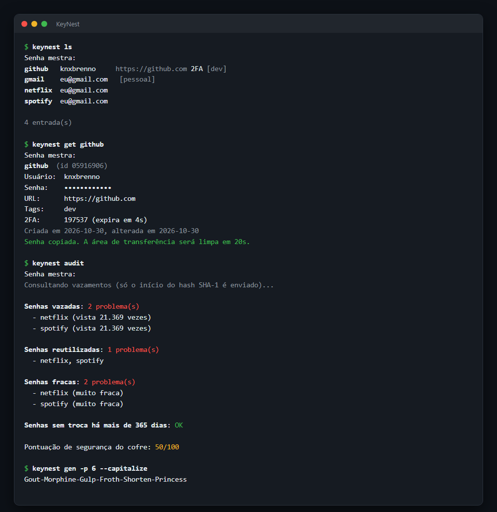

# 🔐 KeyNest

[](https://github.com/knxbrenno/KeyNest/actions/workflows/tests.yml)

Gerenciador de senhas de terminal escrito em Python, com **criptografia de verdade**: AES-256-GCM para o cofre e Argon2id para derivar a chave da senha mestra. Gera senhas e frases-senha seguras, verifica vazamentos sem expor a senha, gera códigos de autenticação em dois fatores (2FA) e audita o cofre em busca de senhas fracas ou repetidas.



## Funcionalidades

- **Cofre criptografado** com AES-256-GCM e chave derivada por Argon2id
- **Gerador** de senhas (tamanho, símbolos, sem caracteres ambíguos) e de **frases-senha** com a lista de palavras da EFF
- **Verificação de força**: entropia estimada, detecção de senhas comuns, sequências, repetições, anos e *leet speak* (`P@ssw0rd`)
- **Verificação de vazamentos** no Have I Been Pwned com k-anonimato: a senha nunca sai do computador
- **Auditoria do cofre**: senhas vazadas, reutilizadas, fracas e sem troca há mais de 1 ano, com pontuação geral
- **2FA (TOTP)**: guarda o segredo e gera os códigos, compatível com Google Authenticator (aceita a URI `otpauth://` do QR Code)
- **Área de transferência segura**: limpa sozinha após 20 s; no Windows, a senha não vai para o histórico (Win+V) nem para a nuvem
- **Histórico** das últimas 10 senhas de cada entrada
- **Importação** de CSV do Chrome, Firefox, Edge, Bitwarden, LastPass e outros; **exportação** em CSV/JSON
- **Modo interativo** (`keynest shell`): desbloqueia uma vez e bloqueia sozinho após 5 minutos sem uso
- Funciona em Linux, macOS e Windows

## Como a criptografia funciona

```
senha mestra ──► Argon2id (64 MiB, 3 iterações, salt aleatório) ──► chave de 256 bits
                                                                        │
entradas (JSON) ──────────────────────────► AES-256-GCM (nonce novo a cada gravação)
                                                                        │
                                       vault.json = cabeçalho + nonce + texto cifrado
```

- **Argon2id** é o vencedor da *Password Hashing Competition*. Ele exige muita memória, o que torna ataques de força bruta com GPU caros: cada tentativa de senha mestra leva cerca de 0,3 s.
- **AES-256-GCM** cifra e **autentica** os dados. Qualquer alteração no arquivo, mesmo de 1 bit, é detectada.
- O **cabeçalho** (parâmetros do Argon2 e salt) entra como dado autenticado (AAD), então um atacante não consegue enfraquecer os parâmetros sem ser detectado.
- Um **nonce novo** é gerado a cada gravação, e o salt muda quando a senha mestra é trocada.
- A gravação é **atômica** (arquivo temporário + `os.replace`), então o cofre não corrompe se o programa for interrompido. Um backup cifrado (`vault.bak`) é mantido.
- Nada é guardado em texto puro, nem os nomes dos sites.

## Instalação

```bash
git clone https://github.com/knxbrenno/KeyNest.git
cd KeyNest
pip install .
```

Isso instala o comando `keynest`. Para usar sem instalar: `pip install -r requirements.txt` e depois `python -m keynest`.

No Linux, a área de transferência precisa de `xclip`, `xsel` ou `wl-clipboard`.

## Uso

```bash
keynest init                                   # cria o cofre (~/.keynest/vault.json)

keynest add github -u knxbrenno -g 24          # gera uma senha de 24 caracteres
keynest add banco -u 12345 --passphrase 6      # gera uma frase-senha de 6 palavras
keynest add email -u eu@gmail.com --totp "otpauth://totp/..." --tags pessoal

keynest ls                                     # lista tudo
keynest ls git                                 # busca
keynest ls -t pessoal                          # filtra por tag

keynest get github                             # mostra os dados e copia a senha
keynest get github -s                          # exibe a senha na tela
keynest get github -f username                 # copia só o usuário
keynest totp email -c                          # copia o código 2FA atual

keynest edit github -g 32                      # troca a senha (a antiga vai para o histórico)
keynest edit github --url https://github.com/login --tags dev,trabalho
keynest rm github

keynest gen -l 32                              # só gera uma senha
keynest gen -p 6 --capitalize --number         # frase-senha: Oxygen-Ample3-Tidal-...
keynest check                                  # avalia uma senha (digitada sem aparecer)

keynest audit                                  # auditoria completa do cofre
keynest import chrome.csv                      # importa senhas do navegador
keynest export backup.csv                      # exporta (texto puro!)
keynest passwd                                 # troca a senha mestra
keynest shell                                  # modo interativo
```

Para usar outro arquivo de cofre: `keynest --vault ~/trabalho.json ...` ou a variável `KEYNEST_VAULT`.

### Importando do navegador

- **Chrome/Edge:** Configurações → Senhas → Exportar senhas
- **Firefox:** about:logins → ⋯ → Exportar logins
- **Bitwarden:** Ferramentas → Exportar cofre → `.csv`

Depois de importar, **apague o CSV**: ele tem as senhas em texto puro.

## Estrutura

```
keynest/
├── crypto.py      # Argon2id + AES-256-GCM
├── vault.py       # Cofre: abrir, salvar (atômico), entradas, histórico
├── generator.py   # Senhas e frases-senha (módulo secrets)
├── strength.py    # Avaliação de força e tempo estimado de quebra
├── pwned.py       # Have I Been Pwned com k-anonimato
├── totp.py        # Códigos 2FA (RFC 6238)
├── clipboard.py   # Área de transferência multiplataforma com limpeza automática
├── cli.py         # Interface de linha de comando
└── wordlist.txt   # Lista de palavras da EFF (7776 palavras)
```

## Testes

```bash
pip install pytest
python -m pytest
```

Os testes cobrem a criptografia (senha errada, adulteração do conteúdo e do cabeçalho, troca de senha mestra), os vetores oficiais da RFC 6238 para TOTP, o gerador, a avaliação de força e a consulta ao HIBP (garantindo que só o prefixo do hash é enviado).

## Limitações

- Se você **esquecer a senha mestra, não há como recuperar** o cofre. Esse é o objetivo.
- Enquanto o cofre está aberto, as senhas ficam na memória do processo; um malware com acesso ao seu usuário poderia lê-las. Isso vale para qualquer gerenciador de senhas.
- Não há sincronização entre dispositivos. Como o arquivo é cifrado, você pode guardá-lo em uma pasta sincronizada (Dropbox, Google Drive, Syncthing).

## Créditos

A lista de palavras é a [EFF Large Wordlist](https://www.eff.org/dice), da Electronic Frontier Foundation, licenciada sob [CC BY 3.0 US](https://creativecommons.org/licenses/by/3.0/us/).
